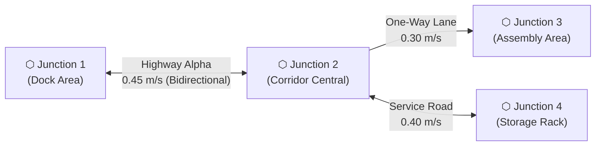

# Road Network Planning &amp; Traffic Control

Topological road network routing, multi-lane traffic flow, speed limits, and dynamic blockage rerouting powered by Nav2 `RouteServer`.

---

## Overview

While standard navigation computes arbitrary trajectories through free space, **Road Network Planning** constrains autonomous transport to a structured topological graph composed of **Junctions (Nodes)** and **Roadways (Edges)**.



### Road Network vs. Preferred Path Zones

| Feature | Preferred Path Zones (Costmap Filter) | Road Network Planning (Nav2 RouteServer) |
|---|---|---|
| **Underlying Engine** | Costmap Cost Penalty Layer | Topological Graph + Nav2 RouteServer |
| **Navigation Space** | Continuous 2D free-space | Strict topological node-to-node graph lanes |
| **Enforcement** | "Soft" preference (planners deviate if blocked) | "Hard" lane constraint with topological routing |
| **Directionality** | Omnidirectional cost scaling | Explicit one-way or bidirectional graph edges |
| **Speed Limits** | Cost-based deceleration | Dedicated per-edge speed limit metadata |
| **Blockage Behavior** | Drives around obstacle in free-space | Reroutes along alternative graph edges, or halts |

### Storage &amp; Map Lifecycle
Road networks are stored in the central SQLite database and mirrored as standard GeoJSON files on disk:
- **Central Storage**: Persisted under the `road_networks` table in SQLite keyed by `map_name`.
- **Disk Artifact**: Exported to `<map_name>_roadnet.geojson` in the package maps directory.
- **Hot Reloading**: Saving a road network while in navigation mode automatically invokes Nav2's `/route_server/set_route_graph` service without restarting nodes.
- **Lifecycle Cleanup**: Deleting a map via `DELETE /maps/{name}` automatically cascades and removes its road network from both database and disk.

---

### <span class="verb get">GET</span> `/road_network`

Fetch the topological road network graph for a map as a GeoJSON FeatureCollection.

#### Request
- **Method**: `GET`
- **Path**: `/road_network`
- **Query Parameters**:
  - `map` (*optional*): Map name. Defaults to the currently active map.
- **Headers**: None required

#### Response
- **Status**: <span class="status ok">200 OK</span>

```json
{
  "map": "workRoom",
  "features_count": 3,
  "geojson": {
    "type": "FeatureCollection",
    "name": "graph",
    "crs": {
      "type": "name",
      "properties": { "name": "urn:ogc:def:crs:EPSG::3857" }
    },
    "features": [
      {
        "type": "Feature",
        "id": "node_1",
        "geometry": { "type": "Point", "coordinates": [1.5, 2.0] },
        "properties": { "type": "node", "name": "Dock Junction" }
      },
      {
        "type": "Feature",
        "id": "node_2",
        "geometry": { "type": "Point", "coordinates": [4.0, 2.0] },
        "properties": { "type": "node", "name": "Aisle Junction" }
      },
      {
        "type": "Feature",
        "id": "edge_1_2",
        "geometry": { "type": "LineString", "coordinates": [[1.5, 2.0], [4.0, 2.0]] },
        "properties": {
          "type": "edge",
          "start_id": "node_1",
          "goal_id": "node_2",
          "bidirectional": true,
          "speed_limit": 0.45
        }
      }
    ]
  }
}
```

| Field | Type | Description |
|---|---|---|
| `map` | `string` | Target map identifier |
| `features_count` | `integer` | Total number of junctions and roadways in the graph |
| `geojson` | `object` | Complete GeoJSON FeatureCollection conforming to RouteServer format |

#### Example (cURL)

```bash
curl -s "$ROBOT/road_network?map=workRoom"
```

---

### <span class="verb post">POST</span> `/road_network`

Save or update the road network topology for a map. Persists into central SQLite storage, writes `<map>_roadnet.geojson` to disk, and immediately hot-reloads into Nav2 RouteServer if navigation is active.

#### Request
- **Method**: `POST`
- **Path**: `/road_network`
- **Headers**: `Content-Type: application/json`

**Payload:**

```json
{
  "map": "workRoom",
  "geojson": {
    "type": "FeatureCollection",
    "name": "graph",
    "crs": {
      "type": "name",
      "properties": { "name": "urn:ogc:def:crs:EPSG::3857" }
    },
    "features": [
      {
        "type": "Feature",
        "id": "node_1",
        "geometry": { "type": "Point", "coordinates": [0.0, 0.0] },
        "properties": { "type": "node", "name": "Origin" }
      },
      {
        "type": "Feature",
        "id": "node_2",
        "geometry": { "type": "Point", "coordinates": [3.0, 0.0] },
        "properties": { "type": "node", "name": "Station 1" }
      },
      {
        "type": "Feature",
        "id": "edge_1_2",
        "geometry": { "type": "LineString", "coordinates": [[0.0, 0.0], [3.0, 0.0]] },
        "properties": {
          "type": "edge",
          "start_id": "node_1",
          "goal_id": "node_2",
          "bidirectional": true,
          "speed_limit": 0.45
        }
      }
    ]
  }
}
```

#### Response
- **Status**: <span class="status ok">200 OK</span>

```json
{
  "saved": true,
  "map": "workRoom",
  "path": "/home/navpromini/NavProMini_ws/install/navpromini_mapping/share/navpromini_mapping/maps/workRoom_roadnet.geojson",
  "nodes_count": 2,
  "edges_count": 1,
  "loaded_live": true
}
```

| Field | Type | Description |
|---|---|---|
| `saved` | `boolean` | `true` when written to database and disk |
| `map` | `string` | Associated map name |
| `path` | `string` | Primary filepath on disk |
| `nodes_count` | `integer` | Count of registered junction nodes |
| `edges_count` | `integer` | Count of registered roadway edges |
| `loaded_live` | `boolean` | `true` if hot-reloaded into active Nav2 RouteServer |

#### Error Codes

| Status | Code | Cause / Resolution |
|---|---|---|
| <span class="status err">400</span> | `invalid_geojson` | Request body missing `FeatureCollection` format |
| <span class="status err">400</span> | `invalid_features` | `"features"` is not an array |

#### Example (cURL)

```bash
curl -s -X POST $ROBOT/road_network \
     -H 'Content-Type: application/json' \
     -d @road_network.json
```

---

### <span class="verb delete">DELETE</span> `/road_network`

Delete the road network graph for a map.

#### Request
- **Method**: `DELETE`
- **Path**: `/road_network`
- **Query Parameters**:
  - `map` (*optional*): Map name. Defaults to active map.
- **Headers**: None required

#### Response
- **Status**: <span class="status ok">200 OK</span>

```json
{
  "deleted": true,
  "map": "workRoom"
}
```

#### Example (cURL)

```bash
curl -s -X DELETE "$ROBOT/road_network?map=workRoom"
```

---

### <span class="verb post">POST</span> `/road_network/reroute`

Trigger an immediate dynamic path recalculation in Nav2 RouteServer. Used when sensors or operators detect an obstruction along the active roadway segment.

#### Request
- **Method**: `POST`
- **Path**: `/road_network/reroute`
- **Headers**: None required
- **Payload**: None required

#### Response
- **Status**: <span class="status ok">200 OK</span>

```json
{
  "ok": true,
  "message": "Route recalculated successfully"
}
```

#### Error Codes

| Status | Code | Cause / Resolution |
|---|---|---|
| <span class="status err">500</span> | `reroute_failed` | RouteServer service unavailable or unable to find detour |

#### Example (cURL)

```bash
curl -s -X POST $ROBOT/road_network/reroute
```

---

### <span class="verb post">POST</span> `/navigation/route`

Command the robot to navigate to a target junction node or waypoint strictly along the road network topological graph with customizable blockage rerouting behavior.

#### Request
- **Method**: `POST`
- **Path**: `/navigation/route`
- **Headers**: `Content-Type: application/json`

**Payload:**

| Field | Type | Required | Description |
|---|---|---|---|
| `goal_id` | `string` | Either this... | Target road network junction node ID (e.g. `"node_3"`) |
| `waypoint` | `string` | ...or this | Target waypoint name (automatically resolved to nearest node or goal pose) |
| `x`, `y` | `number` | ...or coordinates | Explicit destination coordinates |
| `start_id` | `string` | Optional | Starting node ID. If omitted, RouteServer selects the nearest node to the robot's current pose |
| `theta` | `number` | Optional | Arrival heading in radians (default: `0.0`) |
| `reroute_policy` | `string` | Optional | Policy when road segment is blocked: `wait_then_reroute` (default), `immediate`, or `halt_only` |
| `wait_timeout_sec` | `number` | Optional | Seconds to pause and wait for blockage to clear before triggering reroute (default: `5.0`) |
| `replace` | `boolean` | Optional | Cancel active goal and supersede (default: `false`) |

```json
{
  "goal_id": "node_3",
  "reroute_policy": "wait_then_reroute",
  "wait_timeout_sec": 5.0,
  "replace": true
}
```

#### Reroute Policies

- **`wait_then_reroute`** *(Recommended)*: When an obstacle (e.g. human, forklift) blocks the road network edge, the robot stops, flashes caution, and waits up to `wait_timeout_sec` seconds. If the obstacle does not clear, it queries RouteServer for an alternative road network branch.
- **`immediate`**: Reroutes immediately without waiting upon detecting blockage on the current roadway segment.
- **`halt_only`**: Holds position indefinitely or until manually cleared; never takes alternative detours outside the designated roadway.

#### Response
- **Status**: <span class="status warn">202 Accepted</span>

```json
{
  "accepted": true,
  "routing_mode": "road_network",
  "target": {
    "goal_id": "node_3",
    "routing_mode": "road_network",
    "reroute_policy": "wait_then_reroute",
    "wait_timeout_sec": 5.0
  }
}
```

#### Example (cURL)

=== "By node ID with wait-then-reroute"

    ```bash
    curl -s -X POST $ROBOT/navigation/route \
         -H 'Content-Type: application/json' \
         -d '{
           "goal_id": "node_3",
           "reroute_policy": "wait_then_reroute",
           "wait_timeout_sec": 5.0
         }'
    ```

=== "By waypoint name with immediate reroute"

    ```bash
    curl -s -X POST $ROBOT/navigation/route \
         -H 'Content-Type: application/json' \
         -d '{
           "waypoint": "station_loading",
           "reroute_policy": "immediate"
         }'
    ```
