# Robot Setup & Commissioning Guide

Welcome to the **NavPro Mini Autonomous Mobile Robot (AMR)** setup guide. This walkthrough explains how to power on your robot, connect using the **NavPro Mini GUI**, configure Wi-Fi, create your facility map, and verify localization at the charging dock.

Whether you are connecting to an **existing robot** already on your network or **commissioning a brand new robot**, follow the steps below.

---

## 1. Hardware Power-On & LED Status

### Power Button Operation

The robot's power button is located inside the recessed cutout on the orange chassis:

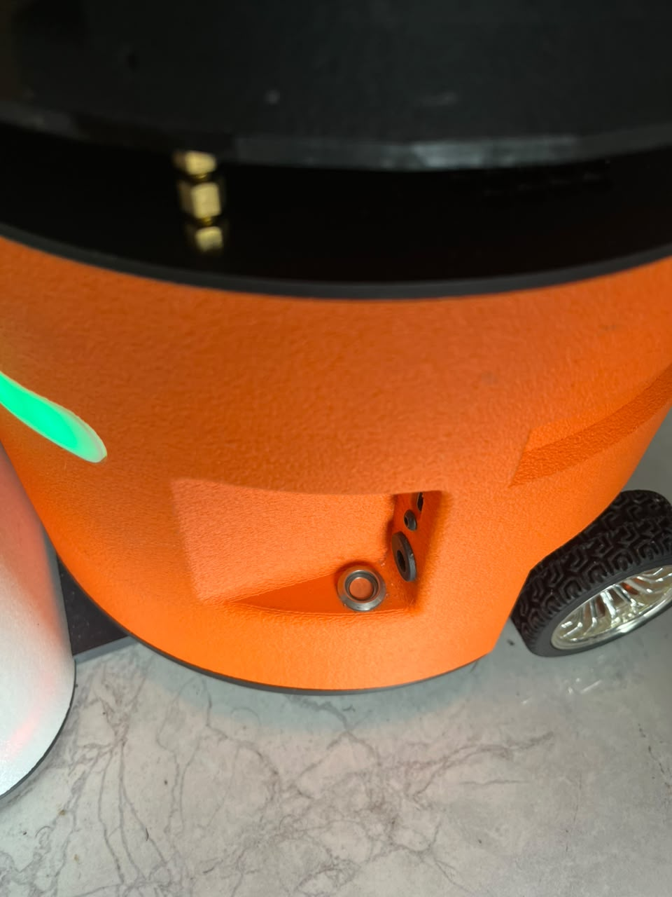{: .setup-photo }

Figure 1: Push button located in the orange chassis cutout.

- **Turn ON**: Press the button down (clicked down / pressed in). The internal computer powers on, and the front and rear chassis LED strips illuminate.
- **Turn OFF**: Press the button again so it pops up (unpressed / clicked up). Power cuts off immediately and the LED strips will stop glowing.
- **Initialization**: Allow **25–30 seconds** after pressing the button down for all onboard systems and ROS 2 services to start up.

---

### Robot Body LED Status Meaning Table

The robot is equipped with **front and rear LED light strips mounted directly on the body chassis**. These strips communicate the robot's real-time state:

| LED Color & Pattern | Robot State | Description & End-User Meaning | Recommended Action |
|:---|:---|:---|:---|
| ● **Solid Red** | **Booting** | Linux OS, onboard computer, and motor controllers are starting up. | Wait ~30 seconds for boot to finish. |
| ● **Solid Amber / Orange** | **Hotspot (AP Mode)** | No known Wi-Fi network found. Broadcasting setup hotspot: `NavPro-Setup-<id>`. | Open the GUI app and select **Set up a new robot**. |
| ● **Solid Green** | **Idle / Ready** | Connected to your local Wi-Fi and ready for operation. SDK API live on port `8090`. | Ready to navigate, dispatch missions, or view the dashboard. |
| ● **Pulsing Blue / Cyan** | **Navigating / Mapping** | Active autonomous mission in progress, teleoperation driving, or SLAM mapping. | Robot is in motion. Keep clearance around the AMR. |
| ● **Breathing Green** | **Docked & Charging** | Contacts engaged with charging base; battery is actively replenishing. | Leave on dock until desired battery level is reached. |
| ● **Bright White** | **Docking in Progress** | Front/rear high-intensity docking illumination active for the AprilTag camera. | Ensure no obstacles block the line-of-sight to the dock. |
| ● / ● **Flashing Red / Amber** | **E-Stop / Alert** | Emergency stop active, obstacle motor stall detected, or critical low battery. | Check GUI alerts tab, clear obstacles, or release software E-Stop. |

---

## 2. Download the NavPro Mini GUI

Before launching the setup wizard, download and install the latest desktop app release for your platform (Linux or Windows):

[:material-download: Download NavPro Mini GUI Releases](https://github.com/botforge-robotics/nav2_mission_planner_gui/releases){ .md-button .md-button--primary target="_blank" rel="noopener noreferrer" }

*(Download the latest package built from the `navpro-mini` branch).*

---

## 3. Launching the Setup Wizard

Launch the **NavPro Mini GUI**. If no robot is connected, the app opens to **Step 1 of 5**:

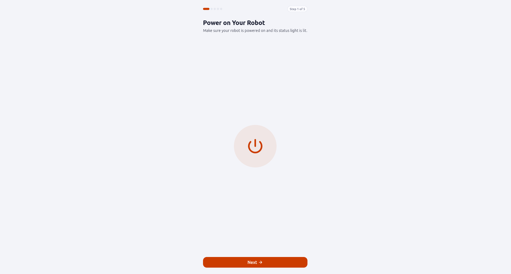{: .setup-screenshot }

Figure 2: Step 1 of 5 — Verifying the robot is powered on.

1. Confirm the power button is clicked down and the body LED strips are glowing.
2. Click **My robot is ready &rarr;**.

---

## 4. Connecting to Your Robot (Existing vs. New Robot)

In **Step 2 of 5**, choose how to connect:

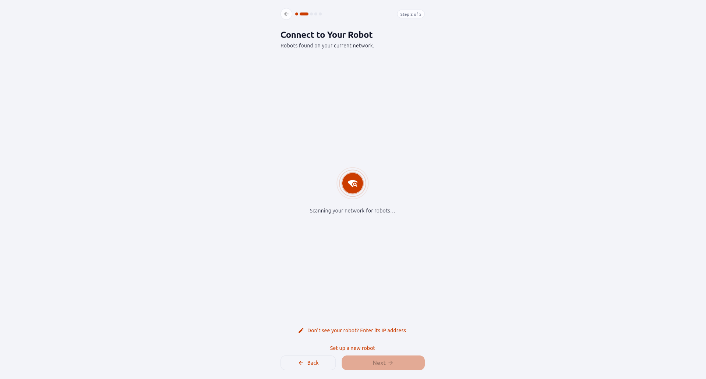{: .setup-screenshot }

Figure 3: Step 2 of 5 — Select an existing robot or commission a new one.

### Path A: Connect to an Existing Robot

If your robot is already connected to your Wi-Fi network:

- The app scans your local network and lists active robots under **Found on your network** (e.g., `navpromini` at `192.168.0.128`).
- Click on the robot's card to connect directly.
- If your robot is on another subnet, click **Enter its IP address** and enter its address manually.

---

### Path B: Set Up a Brand New Robot (First-Time Commissioning)

If this is a new robot or you are setting it up on a new Wi-Fi network:

1. Click **Set up a new robot**.
2. With the body LED strips glowing ● **Solid Amber / Orange**, the app scans for the robot's hotspot:

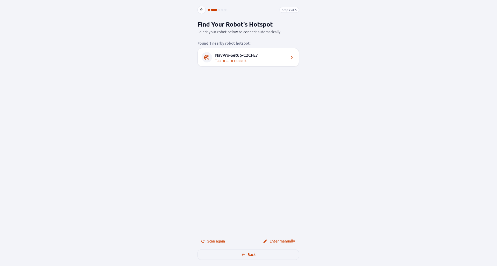{: .setup-screenshot }

Figure 4: Detecting the robot's broadcasted setup hotspot.

3. When the **`NavPro-Setup-*`** hotspot is detected, click **Next &rarr;**.

!!! tip "Manual Hotspot Connection"
    You can also connect your computer or smartphone Wi-Fi directly to `NavPro-Setup-XXXX` and navigate to `http://10.42.0.1`.

---

## 5. Configuring Wi-Fi & Regional Settings

In **Step 3 of 5**, provide your network credentials:

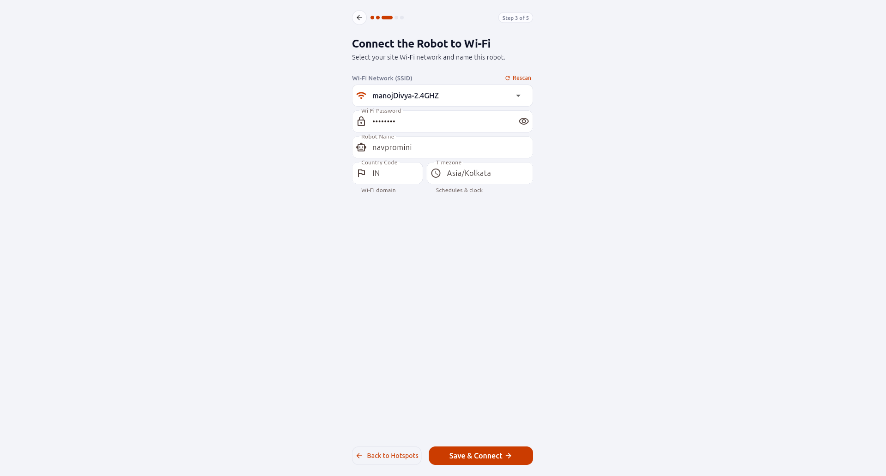{: .setup-screenshot }

Figure 5: Step 3 of 5 — Wi-Fi credentials and configuration.

- **Wi-Fi Network (SSID)**: Select your Wi-Fi network name from the dropdown scan list or enter it manually.
- **Password**: Enter the Wi-Fi password.
- **Robot Name**: Enter a name for your AMR (e.g., `navpromini`).
- **Country Code**: Select your regulatory country domain (e.g., `IN - India`, `US - United States`).
- **Timezone**: Select your local timezone (e.g., `Asia/Kolkata`) for scheduled missions.

Click **Save & Connect &rarr;**.

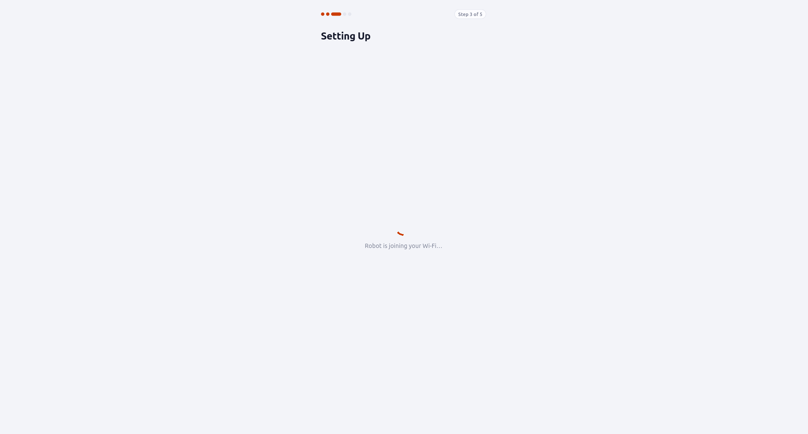{: .setup-screenshot }

Figure 6: The robot connects to your local Wi-Fi network.

The robot saves the credentials, turns off its setup hotspot, and joins your Wi-Fi. The body LED strips change from ● **Amber** to ● **Solid Green**, and the app connects automatically.

---

## 6. Charging Dock Placement & Creating Your First Map

### Dock Placement Guidelines

Before creating your map, position the charging station:

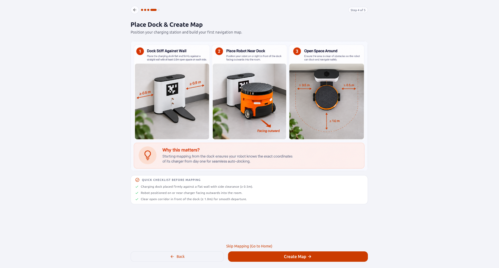{: .setup-screenshot }

Figure 7: Step 4 of 5 — Charging dock placement and clearance rules.

- **Solid Wall**: Place the dock firmly against a flat wall so it cannot push back.
- **Clearance**: Leave at least **0.5 m** clearance on both sides and **1.0 m** clear straight space in front.
- **Starting Position**: Place the robot against the dock contacts **facing outward** into the room. This starting position becomes the $(0, 0)$ origin of your map.

Click **Start Mapping &rarr;**.

---

### Driving with SLAM to Map Your Environment

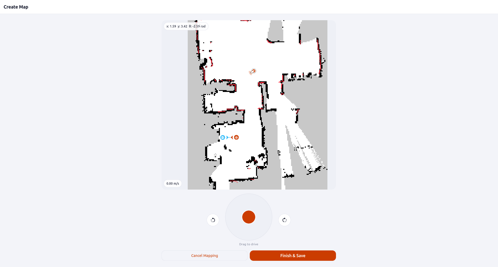{: .setup-screenshot }

Figure 8: Live SLAM mapping with virtual joystick.

- **Drive Around**: Use the center orange joystick ("Drag to drive") or the rotation buttons to drive the robot smoothly through all rooms and corridors.
- **Observe the Map**: Watch the map form in real time — white indicates free walkable space, black lines represent walls, and ● red dots show real-time laser reflections.
- **Finish & Save**: Once the perimeter of your rooms is mapped with no gaps, click **Finish & Save**, give the map a name (e.g., `t202`), and save. The map is automatically compiled and loaded into Nav2 navigation.

---

## 7. Setup Complete & Operational Dashboard

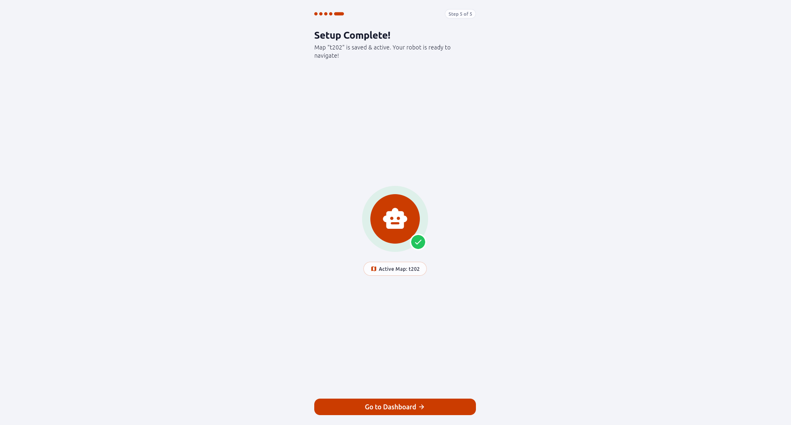{: .setup-screenshot }

Figure 9: Step 5 of 5 — Setup complete.

Click **Go to Dashboard &rarr;** to access the main operations view:

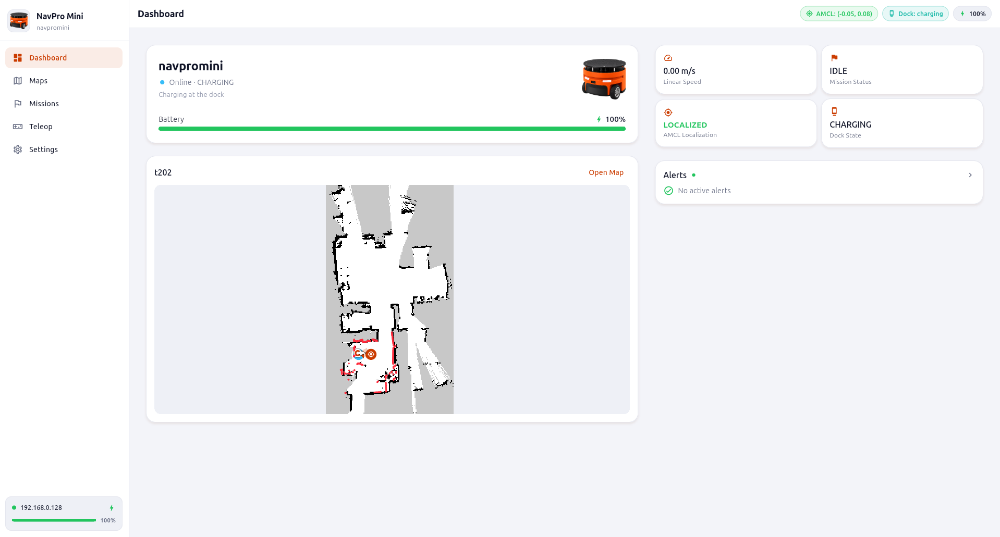{: .setup-screenshot }

Figure 10: NavPro Mini GUI operational dashboard.

The dashboard gives you an at-a-glance view of your robot: live battery percentage, connection status, driving speed, AMCL localization state, charger status, and a real-time map preview. Use the left sidebar to navigate between **Dashboard**, **Maps**, **Missions**, and **Teleop**.

---

## 8. Relocalizing at the Dock After Mapping

After finishing mapping, place or drive the robot back onto its charging station. If the robot does not automatically localize to the dock position, use the relocalization tools:

1. Click **Maps** in the left sidebar:

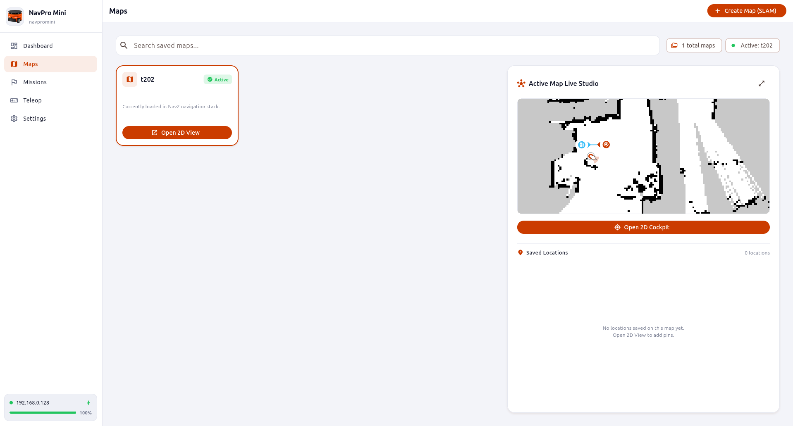{: .setup-screenshot }

Figure 11: Maps screen showing active map and Open 2D Cockpit button.

2. Click **Open 2D Cockpit** to enter the cartography workspace:

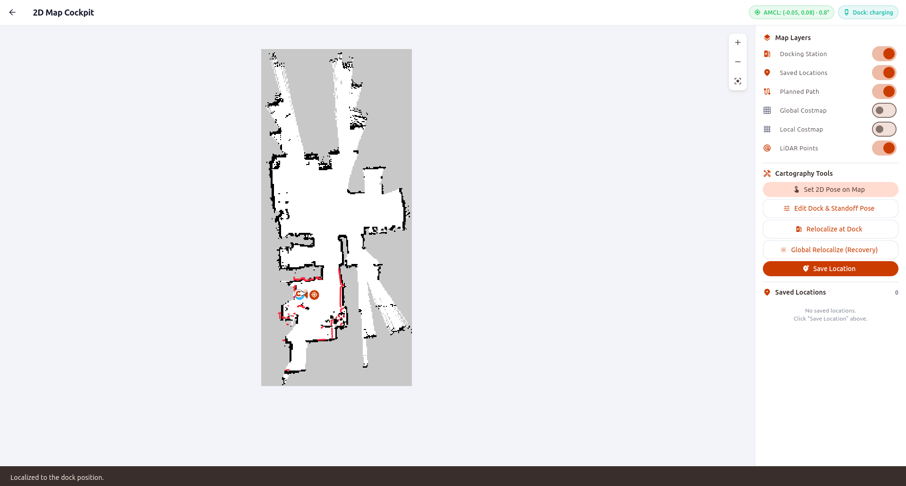{: .setup-screenshot }

Figure 12: 2D Map Cockpit with Cartography Tools panel.

3. In the right-hand **Cartography Tools** panel:
   - **Relocalize at Dock**: If the robot is sitting on the charging dock, click **Relocalize at Dock**. The robot will immediately snap its position to the dock origin, and the confirmation banner *"Localized to the dock position"* will appear.
   - **Set 2D Pose on Map**: If the robot is somewhere else in the room, click this button, then click on the map at the robot's physical location and drag the arrow in the direction the robot is facing.
   - **Global Relocalize (Recovery)**: If the robot is lost, click this to disperse AMCL particles across the map; rotate or nudge the robot so the laser scan matches the walls.
   - **Save Location**: Tap any spot on the map to save named navigation waypoints.

---

## Next Steps

With your robot commissioned, mapped, and localized at the dock, you can automate missions:

- **[Getting Started with APIs](getting-started.md)**: Control the robot via HTTP REST curl commands.
- **[Python SDK & MCP Guide](clients.md)**: Automate in Python or hook into AI agents (Antigravity, Claude, Cursor).
- **[API Reference](api/index.md)**: Explore the complete REST and WebSocket endpoints.
